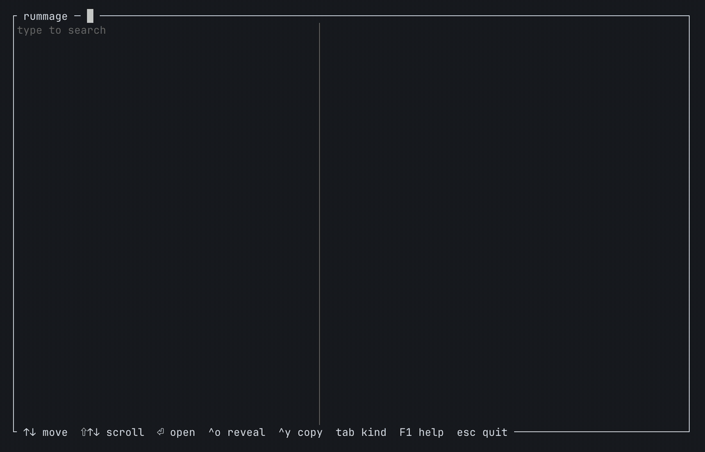

# rummage

Instant multimodal semantic file search for the Unix terminal. Describe what you're looking for, and rummage finds it
by meaning and by exact words, locally, on any GPU or CPU. Type `rummage` for a yazi-style interface, or use it inside
yazi with the plugin.

<p align="center"></p>

**Status: milestones 1–8 of 10.** Search works end to end over text, Markdown, PDFs (page by page), Word
(docx), OpenDocument (odt) and HTML files, and, with `--code`, source code, through a background service that keeps
searches instant, with a search-as-you-type interface and live grep beside meaning search. Photos and screenshots
are found by what they show (and screenshots and scanned pages by their words, through OCR); recordings and videos
by what's said and shown, landing on the moment. The yazi plugin is coming.

## Build

You need Rust, CMake, git and a C++ compiler (Xcode Command Line Tools on macOS, `build-essential` and `clang` on
Linux). For PDFs, install poppler (`brew install poppler`, `apt install poppler-utils`, `dnf install poppler-utils`);
for recordings and videos, ffmpeg (`brew install ffmpeg`, `apt install ffmpeg`); for the words in screenshots and
scans, tesseract (`brew install tesseract`, `apt install tesseract-ocr`); for iPhone
HEIC photos on Linux, libheif (`apt install libheif-examples`). Without them those parts are left out, and
`rummage index` says so.

```sh
git clone --recurse-submodules https://github.com/jonathankeogh/rummage && cd rummage
cargo build --release                    # macOS: Metal. Linux: CPU, or add --features cuda / --features vulkan
```

The model is [EmbeddingGemma 2](https://huggingface.co/google/embeddinggemma-2) (Apache 2.0): 310 MB for text, and
555 MB more for pictures, sound and video. The first time rummage needs it, it asks, then downloads it from Hugging
Face with `curl` into `~/.local/share/rummage/models` and checks it. Say no and it prints the folder and the `curl`
commands, to do it yourself (or point `RUMMAGE_MODELS` at a folder that has the files, say on a machine without
internet). A copy already in the Hugging Face cache (`hf download`) is used as it is.

## Use

```sh
rummage                                  # the interface: type to search, ↑↓ to move, ⏎ to open, F1 for help
                                         #   (^v on a PDF shows the page itself, ←→ turn pages; ^s listens to a
                                         #    recording or video from its moment; RUMMAGE_PICTURES=halfblocks if
                                         #    your terminal doesn't answer its graphics query)
rummage index ~/Documents ~/notes        # add folders and index them (afterwards the service keeps up with them)
rummage search "the clause about pets in the lease"
rummage search INV20931                  # exact words count too
rummage search "/INV\d{5}/"              # a regex: grep runs over text and code files beside meaning search
rummage index --music ~                  # also read songs and music videos (music folders are left out otherwise)
rummage index --code ~/code              # also read code in code projects...
rummage search "code: retry a failed call with backoff"   # ...and search it with "code:"
rummage index --remove ~/old-backup      # stop indexing a folder (its files leave the index)
rummage status                           # the index, and which optional tools are installed
```

Searches go through a small background service that keeps the model loaded, so after the first one they take about
10 ms. The first search starts it, and it quits after 15 idle minutes. While it runs it keeps the index up to date:
it catches up with what changed while it was off, indexes new and changed files a few seconds after they land (and
drops deleted ones), and rebuilds an index made by an older rummage, searching what's done meanwhile. The interface
shows "indexing · N files to go" while it works. `rummage watch` keeps it running for good, and `rummage watch
--install` starts it at login (launchd on macOS, a systemd user service on Linux). `rummage stop` stops it, and
`rummage search --no-serve` skips it. Its log is `serve.log` in the index folder.

Recordings and videos show their sound as a waveform, the matched stretch marked; ^s plays it from there through mpv
(or ffmpeg's ffplay), and ⏎ opens it in mpv or VLC at the moment.

To remove rummage entirely: `rummage watch --uninstall` (if you installed the login item), `rummage stop`, then delete
the binary and `~/.local/share/rummage` (or `$XDG_DATA_HOME/rummage`), which holds the index and the model files.

`--json` on search prints results for scripts. The index lives in `$XDG_DATA_HOME/rummage` (or
`~/.local/share/rummage`); set `RUMMAGE_INDEX` or `--index` to use another. `RUMMAGE_MODELS` points at a folder with
the model files instead of the Hugging Face cache.

## What it reads

Text and Markdown, PDFs a page at a time (scanned pages as pictures, read by OCR), docx, odt and html, photos and
screenshots (JPEG, PNG, HEIC, WebP, GIF, BMP, TIFF; icons under 256 px and dataset folders of machine-named pictures
are left out), recordings of any length (MP3, M4A, WAV, FLAC, Ogg, Opus …, in overlapping 30 s windows; silence
skipped) and videos (MP4, MOV, MKV, WebM, AVI, MPEG-TS …: a frame per shot plus the sound; a TypeScript .ts stays
code), and with `--code` source code and notebooks, in projects and as loose scripts. Long files go in passes: the
first 30 pages of a big PDF, 40 passages of a long document or 10 minutes of a recording or video right away, the rest
once everything else is in, so a 500-page PDF or a film can't hold up the first pass (`rummage status` says how far it
has got: "Film.mp4 30 of 118 minutes"). Scanned PDFs (no text) wait for OCR. A video under 5 seconds (a Live Photo's
clip) is read as one picture, its middle frame. Text that's mostly numbers (a data dump, a CSV saved as .txt) gets 3
passages embedded and the rest left to its words and grep.

Music folders (`~/Music`, Apple Music and iTunes libraries) are left out unless you ask for them with `--music`: a
library of songs is days of sound to read, and rarely what you're looking for. Files whose names aren't readable text
(another system's encoding, as old zips leave them) are left out and counted.

In an Apple Photos library only the originals are read (macOS asks for Full Disk Access first; `rummage index` says
so), not its thumbnails and edited copies, and Lightroom's previews are skipped.

Files in iCloud Drive (with Optimize Mac Storage), Dropbox, OneDrive or Google Drive that aren't downloaded to the Mac
are left out, never downloaded to be read, and counted in `rummage status`; one downloaded later is read then. On Linux,
network and cloud mounts (rclone, sshfs, NFS, SMB …) inside a folder are left out unless added as folders themselves.

Each file's content is hashed (BLAKE3), so a copy is read once and found as one result that says where the others are
("also in ~/Downloads, ~/Backup"), and a moved or renamed file, or a whole folder of them, reads nothing again. A file
that keeps changing (a log, a download, a document being worked on) is read once it has been still for 5 minutes, not
at every change. A program that hangs on a file (poppler, tesseract, ffmpeg) is stopped after a minute; a file that
can't be read is left out whole, with the reason in `rummage status`, and tried again when it changes or rummage is
updated.

Only the folders you add. It never reads hidden folders, keys, certificates or password files, dependency folders
(`node_modules`, `venv` …) or `~/Library`. Inside a code project (a folder with `.git`, `Cargo.toml`, `package.json`
…) it reads nothing unless you pass `--code`, and then skips what git ignores and vendored or built folders.

## How it works

Every search does two things at once. Meaning search: the query is embedded and compared with every passage
(passages that are a little similar to everything, like menus and boilerplate, are held back). Live grep: the query's
exact text (or a `/regex/`) in the text and code files themselves, newest first, up to 20 files or 3 seconds, so it
also finds files too big to index. One score orders both: meaning, plus a bonus for the query's words or a grep match,
plus a little for being recent. The interface shows meaning results at once and merges grep's as they arrive.

Words match with their English endings ("invoices" finds "invoice"); the word you're still typing matches as the start
of longer words ("invo" finds "invoice"). A query made of codes (`INV-20931`, `0x80070005`, `ECONNRESET`,
`refreshAccessToken`, `max_retries`) is an exact lookup: the words count double and meaning half. In a `code:` search
words count half as much as elsewhere, since code repeats the same words everywhere.

Text is cut into ~1,800-character passages, each embedded by EmbeddingGemma 2 through llama.cpp (pinned in
`vendor/llama.cpp`, built by `crates/llama-sys`). One SQLite file holds a vector per passage plus an FTS5 keyword
index. A search scores every vector, keeps passages that stand out for that query, and boosts files that contain the
query's words.

The search service keeps every vector in memory, about 1.5 GB per million passages (a few thousand long PDFs), plus
about 300 MB for the model, and 550 MB more while it reads pictures, sound or video. Keep the index on a disk in the
computer: SQLite can't lock its files reliably on a network drive (NFS, SMB), and rummage warns when it's on one.

## Tests

`cargo test --release` runs the unit tests everywhere. With the model files present it also runs
`tests/reference_vectors.rs` (rummage's vectors must match DigUp's reference vectors, cosine ≥ 0.999) and
`tests/end_to_end.rs` (index, re-sync, long files in two passes, the service, grep, crash recovery); without them those
skip (CI keeps the model in GitHub's cache, so they run there). `uv run scripts/edge_cases.py` builds the files that
once made indexing slow, stuck or wrong (a tool that hangs, a password-protected PDF, a Photos library, a file written
every 2 s, a 40-minute recording, clips, number dumps, copies and moves) and checks each against the release build;
`uv run scripts/edge_cases.py icloud` does the same with a test file in your iCloud Drive. `scripts/eval.py` measures ranking on DigUp's eval sets: build the text parts of its testbed
somewhere outside a code project (e.g. `~/.cache/rummage-eval`) and see the script's header. `scripts/sweep.py` runs
every eval set with one ranking weight changed at a time (each weight can be overridden by `RUMMAGE_<NAME>`, e.g.
`RUMMAGE_WORD_WEIGHT=1.5`).

`sh demo/record.sh` films the demo above again on macOS, from files it makes or that are public domain
(`demo/photos`).

## License

MIT (see [LICENSE](LICENSE)).

Credits: [DigUp](https://github.com/ARahim3/DigUp) for the approach, skip rules and ranking (see
[THIRD_PARTY_NOTICES.md](THIRD_PARTY_NOTICES.md)), [llama.cpp](https://github.com/ggml-org/llama.cpp) and
[yazi](https://github.com/sxyazi/yazi).
